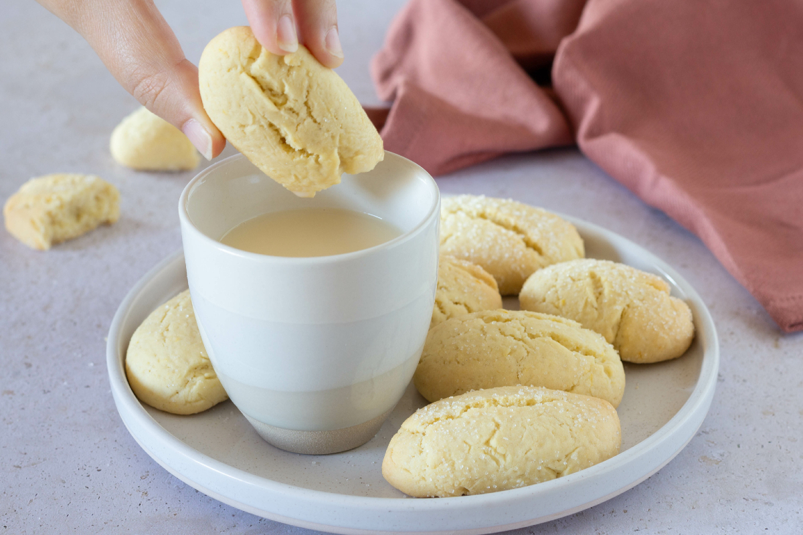

## Ingredienti

| Ingredienti                  | Ingredienti             |
| ---------------------------- | ----------------------- |
| **500g** - Farina 00 | **180g** - Zucchero |
| **100g** - Olio di semi | **2** - Uova |
| **16g** - Lievito in polvere | **1** - Scorza di limone |

## Procedimento

> Preriscaldare il forno a 180°C

1. Versa in una ciotola lo zucchero e le uova, poi profuma con la scorza di limone.
1. Aggiungi l’olio di semi di girasole e mescola con un cucchiaio per amalgamare, quindi unisci il lievito.
1. Incorpora la farina 00 poco alla volta, continuando a mescolare. Quando l’impasto avrà preso consistenza, lavoralo con le mani.
1. Impasta fino a ottenere un panetto morbido e non appiccicoso.
1. Preleva un pezzetto di impasto alla volta e forma dei filoncini, poi schiacciali leggermente. Con queste dosi otterrai circa 30 biscotti.
1. Passa ogni biscotto nello zucchero semolato e sistemalo su una teglia rivestita con carta forno.
1. Cuoci in forno statico preriscaldato a 180°C per 15-18 minuti.
1. Sforna i biscotti e lasciali raffreddare completamente prima di gustarli. 

## Note

- Quando formi i biscotti, cerca di realizzarli tutti della stessa dimensione, così cuoceranno in maniera uniforme.
- Per conservarli friabili più a lungo, lasciali raffreddare completamente e riponili in una scatola di latta.
- Se invece vuoi renderli più golosi, puoi aggiungere delle gocce di cioccolato direttamente all’impasto prima di formare i biscotti.

## Origine

[link](https://www.giallozafferano.it/la-ricetta-del-giorno-di-giallozafferano-biscotti-da-inzuppo)

