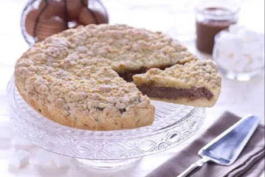

---
tags:
  - Nutella
---

## Ingredienti

### Per la frolla

| Ingredienti                  | Ingredienti             |
| ---------------------------- | ----------------------- |
| **500g** - Farina 00 | **200g** - Burro freddo |
| **5g** - Lievito in polvere per dolci | **1** - Baccello di vaniglia |
| **1 pizzico** - Sale fino | **110 g** - Uova (2) |
| **300g** - Zucchero a velo | |

### Per il ripieno

| Ingredienti                  | Ingredienti             |
| ---------------------------- | ----------------------- |
| **200g** - Nutella | **600g** - Ricotta vaccina |

## Procedimento

> Preriscaldare il forno a 180°C

1. Per preparare la ricetta perfetta della sbriciolata alla Nutella iniziate dalla frolla: mettete nel mixer la farina e il lievito setacciati, unite il burro freddo a pezzetti, aromatizzate con i semi della bacca di vaniglia, aggiungete anche il sale, azionate le lame e frullate il tutto fino ad ottenere una consistenza sabbiosa, non morbida. 
1. Trasferite il composto in una ciotola larga, unite lo zucchero a velo, le uova e mescolate velocemente con la punta delle dita sbriciolando la frolla. Coprite poi con la pellicola per alimenti e riponete in frigorifero per un'ora. 
1. A questo punto preparate il ripieno: setacciate la ricotta (se necessario lasciatela scolare in frigorifero almeno un paio di ore), aggiungete la nutella mescolate con una spatola fino ad ottenere una crema omogenea.
1. Foderate con carta da forno una tortiera tonda dal diametro di 28 cm e ponete sul fondo un po' più della metà della frolla sbriciolata formando un bordino, schiacciate leggermente con le mani, poi aggiungete sopra il ripieno alla nutella e livellate la superficie senza spargere sul bordo il composto.
1. Ricoprite con le briciole rimaste avendo cura di coprire bene il ripieno. Infornate a 180° in modalità statica per 80 minuti: trascorsi 40 minuti ruotate lo stampo per cuocere uniformemente, proseguite la cottura e quando mancano 20 minuti dalla fine ricoprite con un foglio di alluminio. Sfornate la sbriciolata alla Nutella, fatela raffreddare e poi servitela.

## Note

- La sbriciolata alla Nutella si conserva in frigorifero coperta da pellicola per un paio di giorni.
- Se preferite potete congelare la torta oppure solo il crumble e poi scongelarlo in frigo all'occorrenza.
- Se utilizzate uno stampo di metallo fate attenzione alla cottura, i tempi potrebbero ridursi leggermente! 

## Origine

[link](https://ricette.giallozafferano.it/Torta-sbriciolata-alla-Nutella.html)

