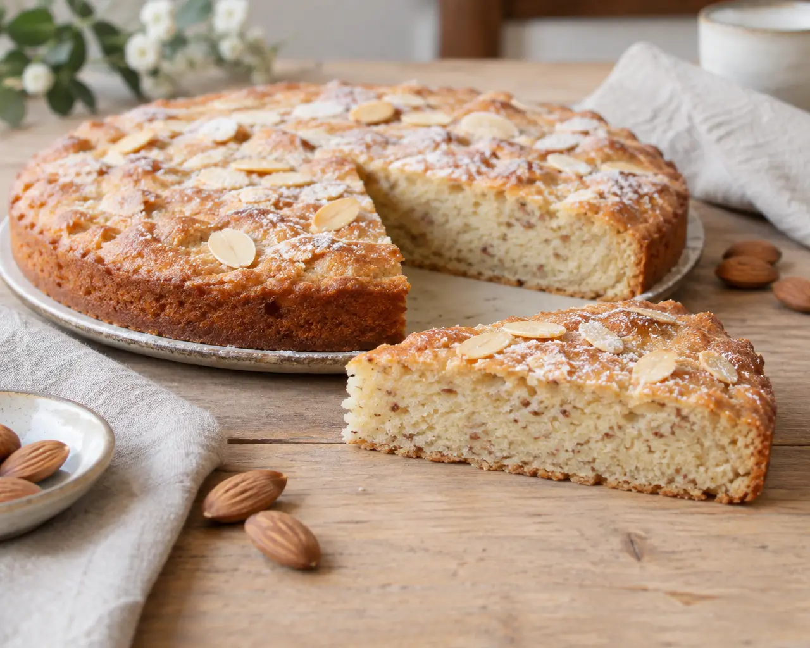

## Ingredienti

| Ingredienti                  | Ingredienti             |
| ---------------------------- | ----------------------- |
| **100g** - Mandorle pelate | **100g** - Zucchero |
| **50g** - Fecola di patate | **4** - Albumi |
| **50g** - burro | **1 cucchiaino** - Lievito in polvere |
| Mendorle a lamelle o tritate | Zucchero a velo |

## Procedimento

> Preriscaldare il forno statico a 180°C.

1. Tritare finemente le mandorle pelate con il tritatutto, facendo attenzione a non lavorarle troppo a lungo per evitare che rilascino il loro olio.
1. Sciogliere il burro a fuoco dolce oppure nel microonde e lasciarlo intiepidire.
1. In una ciotola riunire le mandorle tritate, lo zucchero, la fecola di patate e il lievito setacciati.
1. Mescolare con un cucchiaio per distribuire uniformemente tutti gli ingredienti.
1. In una seconda ciotola, perfettamente pulita e asciutta, montare gli albumi a neve con le fruste elettriche.
1. Dovranno diventare bianchi e spumosi, abbastanza sostenuti da incorporare aria nell’impasto.
1. Unire gli albumi montati agli ingredienti secchi, poco alla volta, mescolando delicatamente con una spatola dal basso verso l’alto.
1. Quando il composto sarà abbastanza omogeneo, aggiungere il burro fuso ormai tiepido, versandolo lentamente e continuando a mescolare con delicatezza.
1. Non lavorare troppo l’impasto, per non smontare gli albumi.
1. Versare il composto nella tortiera e livellare delicatamente la superficie.
1. Distribuire qualche mandorla a lamelle o tritata grossolanamente.
1. Cuocere nel forno statico preriscaldato a 180°C per circa 25–30 minuti, controllando la cottura con uno stecchino.
1. La torta dovrà risultare leggermente dorata in superficie. Se necessario, prolungare la cottura di qualche minuto.
1. Sfornare la torta e lasciarla intiepidire nello stampo prima di trasferirla su un piatto da portata.
1. Quando sarà completamente fredda, spolverizzare con poco zucchero a velo e servire a fette.

## Note

- Potete sostituire i 100 g di mandorle pelate con la stessa quantità di farina di mandorle. Sceglietene una fine, possibilmente ottenuta da mandorle pelate.
- Per ottenere un buon risultato, è importante che il burro fuso non sia caldo quando viene aggiunto e che gli albumi vengano incorporati senza mescolare energicamente.
- Un altro piccolo consiglio: utilizzate una tortiera da 20 cm se preferite una torta leggermente più alta, oppure da 22 cm per un dolce più basso e una cottura tendenzialmente più rapida.
- Potete provare a utilizzare 50 g di amido di mais al posto della fecola. La consistenza potrebbe cambiare leggermente, ma entrambi sono adatti a questo tipo di preparazione.
- È normale che questa torta rimanga piuttosto bassa: contiene molte mandorle, pochi amidi e una piccola quantità di lievito. La sua caratteristica è una consistenza morbida e leggermente umida, non quella di un pan di Spagna molto alto.

## Origine

[link](https://blog.giallozafferano.it/renatabriano/ricetta-torta-di-mandorle-e-albumi-senza-glutine/)

