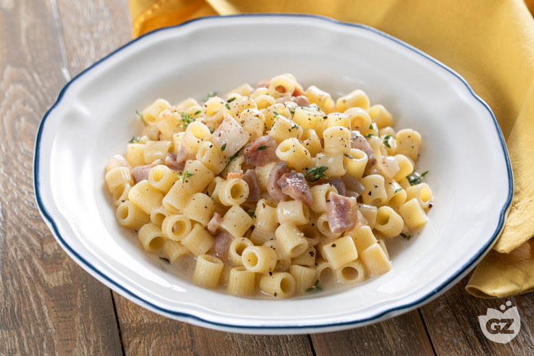

---
tags:
  - Guanciale
  - Pecorino romano
---

## Ingredienti

| Ingredienti                  | Ingredienti             |
| ---------------------------- | ----------------------- |
| **320g** - Ditalini | **200g** - Guanciale |
| **80g** - Pecorino romano | **50g** - Vino bianco |
| Timo | **1 spicchio** - Aglio |
| Basilico | Pepe nero |
| Sale | |

## Procedimento

1. Per preparare la pasta alla mattacchiona cominciate dal guanciale. Togliete la cotenna e riducetelo a cubetti di 2 cm.
1. In una padella unite il guanciale tagliato ad uno spicchio d'aglio. Lasciate cuocere a fuoco medio per 5 minuti, dopo di che sfumate con il vino bianco.
1. Lasciate evaporare l'alcol e profumate con delle foglie di basilico fresco.
1. Quando il condimento sarà pronto eliminate lo spicchio d'aglio, nel frattempo tuffate in acqua bollente salata i ditalini.
1. Scolate i ditalini al dente nella padella insieme al condimento.
1. Ora con delle mestolate di acqua calda portate a cottura la pasta.
1. Fuori dal fuoco occupatevi della mantecatura versando il Pecorino grattugiato. 
1. Aiutatevi con poca acqua di cottura per creare una golosa cremina.
1. Impiattate e insaporite con il pepe nero e del timo fresco.
1. La vostra pasta alla mattacchiona è pronta da gustare bella calda!

## Origine

[link](https://ricette.giallozafferano.it/Pasta-alla-mattacchiona.html)

