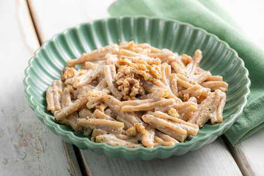

---
tags:
  - Miele
  - Noci
---

## Ingredienti

| Ingredienti                  | Ingredienti             |
| ---------------------------- | ----------------------- |
| **320g** - Caserecce integrali | **120g** - Gherigli di noci |
| **70 g** - Parmigiano | **15g** - Miele |
| Sale e pepe | |

## Procedimento

1. Per preparare la pasta con pesto di noci e miele iniziate cuocendo le casarecce integrali in acqua bollente e salata. Intanto versate le noci nel boccale del mixer assieme al formaggio grattugiato.
1. Unite l'olio, il miele e versate un po' di acqua della cottura della pasta.
1. Aggiungete sale, pepe e frullate. A questo punto la pasta dovrebbe essere al dente, scolatela in una ciotola e condite subito con la salsa.
1. Mescolate bene poi impiattate. Guarnite con un po' di formaggio, qualche gheriglio di noce spezzettato e un filo di miele.

## Note

- Aggiungete l’acqua di cottura della pasta al pesto poco alla volta, così da regolarne la consistenza senza renderlo troppo liquido. 
- Per un gusto più intenso, potete tostare leggermente i gherigli di noce in padella prima di frullarli: basteranno pochi minuti, facendo attenzione a non farli scurire troppo.

## Origine

[link](https://)

