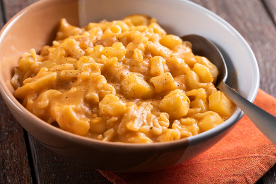

---
tags:
  - Lardo
  - Cipolle
  - Patate
---

## Ingredienti

| Ingredienti                  | Ingredienti             |
| ---------------------------- | ----------------------- |
| **320g** - Pasta mista | **800g** - Patate |
| **2** - Cipolla bianca | **150g** - Lardo |
| **20g** - Concentrato di pomodoro | **1 crosta** - Parmigiano reggiano |
| Olio evo | Sale e pepe |

## Procedimento

1. Per preparare la pasta e patate alla napoletana mondate e tritate la cipolla, sminuzzate la crosta di Parmigiano a pezzetti. Pelate e tagliate le patate a cubetti di circa 1,5 cm. 
1. Riducete a listarelle sottili il lardo. In una pentola alta soffriggete in poco olio le listarelle di lardo, lasciatele rosolare qualche minuto a fuoco dolce.
1. Quando avranno rilasciato il grasso versate la cipolla e stufate per 1-2 minuti, poi unite le croste di formaggio e le patate. Fate insaporire ancora un paio di minuti.
1. Incorporate ora il concentrato di pomodoro e 1 litro d'acqua a temperatura ambiente. Mettete un pizzico di sale, coprite con il coperchio e lasciate cuocere 30 minuti. 
1. Trascorso questo tempo buttate la pasta: mescolate di tanto in tanto affinché la pasta rilasci tutto il suo amido e le patate tendano a sfaldarsi un pochino. Se necessario aggiungete ancora poca acqua. Una volta pronta, servite la pasta e patate alla napoletana ben calda.

## Note

- Per un tocco più fresco potete aggiungere del sedano tritato in cottura insieme alla cipolla.
- Una delle versioni più ricche e golose della pasta e patate alla napoletana prevede l’aggiunta di quella che in Campania è conosciuta come provola o mozzarella affumicata. Basterà tagliarla a cubetti e lasciarla sciogliere a fine cottura mantecando per bene finché non diventa filante e cremosa.

## Origine

[link](https://ricette.giallozafferano.it/Pasta-e-patate-alla-napoletana.html)

