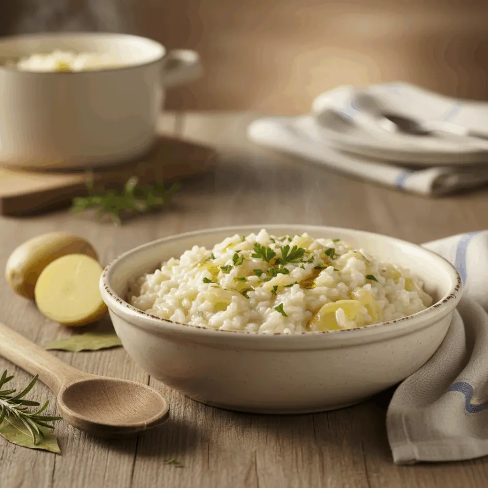

## Ingredienti

| Ingredienti                  | Ingredienti             |
| ---------------------------- | ----------------------- |
| **230g** - Riso | **1** - Cipolla |
| **3** - Patate grandi | **1l** - Brodo vegetale |
| Prezzemolo | Sale e pepe |
| Olio evo | **80g** - Parmigiano reggiano grattuggiato |

## Procedimento

1. Scaldare il brodo vegetale.
1. Sbucciare le patate, lavarle e tagliarle a piccoli tocchetti.
1. Affettare sottilmente la cipolla. Tritare il prezzemolo.
1. Far appassire la cipolla nella risottiera con olio per due minuti. Unire le patate e il prezzemolo e far insaporire due minuti.
1. Aggiungere il riso, farlo tostare un minuto poi cominciare a bagnare con il brodo fino a cottura. Ci vorranno circa 15 minuti.
1. Lasciarlo più o meno brodoso. Va a gusti! Poi spegnere il fuoco, mantecare con il parmigiano grattugiato. Far riposare qualche minuto e servire caldo.

## Origine

[link](https://blog.giallozafferano.it/renatabriano/ricetta-riso-e-patate/)

