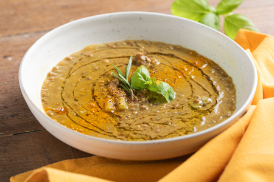

---
tags:
  - Lenticchie
  - Curcuma
  - Zenzero
---

## Ingredienti

| Ingredienti                  | Ingredienti             |
| ---------------------------- | ----------------------- |
| **500g** - Lenticchie precotte | **100g** - Cipolle |
| **100g** - Sedano | **800g** - Brodo vegetale |
| **1 cucchiaino** - Curcuma in polvere | **1 cucchiaino** - Zenzero in polvere |
| Basilico | Olio evo |
| Sale e pepe | |

## Procedimento

1. Per preparare la zuppa di lenticchie con curcuma e zenzero, per prima cosa affettate sia il sedano che la cipolla. Versate le verdure in una casseruola con un giro d’olio, salate e pepate.
1. Aggiungete lo zenzero e la curcuma in polvere, poi soffriggete dolcemente per 5 minuti.
1. A questo punto unite le lenticchie precotte e mescolate per un paio di minuti per farle insaporire, dopodiché versate quasi tutto il brodo vegetale. Portate a leggero bollore e cuocete per 10-15 minuti.
1. A fine cottura, frullate una parte della zuppa con un mixer a immersione. potete regolare la consistenza aggiungendo eventualmente il brodo rimasto. Impiattate e guarnite con un paio di foglioline di basilico.
1. Infine completate con un filo d’olio, un pizzico di curcuma e una macinata di pepe. La vostra zuppa di lenticchie con curcuma e zenzero è pronta per essere servita

## Note

- Conservazione
    - La zuppa di lenticchie con curcuma e zenzero si può conservare in frigorifero per 3 giorni.
    - Potete congelarla.
- Se preferite utilizzare le lenticchie secchie, cuocetele prima a parte in acqua bollente seguendo le indicazioni riportate sulla confezione.
- Aggiungete al soffritto un pezzetto di peperoncino fresco per un tocco piccante.
- Se desiderate, potete arricchire la zuppa di lenticchie con cereali, riso o pasta.

## Origine

[link](https://ricette.giallozafferano.it/Zuppa-di-lenticchie-con-curcuma-e-zenzero.html)

