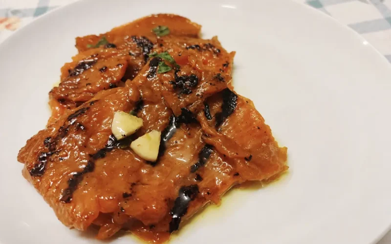

---
tags:
  - Zucca
---

## Ingredienti

| Ingredienti                  | Ingredienti             |
| ---------------------------- | ----------------------- |
| **800g** - Zucca | Olio di semi (per friggere) |
| **1/2 bicchiere** - Aceto | Menta fresca |
| **2 spicchi** - Aglio | Olio evo |
| Sale | |

## Procedimento

1. Pulite accuratamente la zucca privandola della buccia, dei semi e dei filamenti spugnosi. Tagliatela a fette regolari. Attenzione allo spessore: non fatele trasparenti o in frittura spariranno, ma non fatele nemmeno troppo spesse (mezzo centimetro è l’ideale).
1. Scaldate l’olio di semi in una padella bella capiente. Friggete le fette di zucca rigirandole delicatamente, finché non avranno assunto un bel colore dorato e leggermente caramellato.
1. Scolatele man mano su un vassoio rivestito di carta assorbente e salatele subito, in modo che il calore faccia sciogliere e penetrare il sale.
1. Mentre la zucca si intiepidisce, preparate l’anima della ricetta: in una ciotolina o in un bicchiere, mescolate il mezzo bicchiere di aceto di vino bianco con un paio di cucchiai di buon olio extravergine. Aggiungete gli spicchi d’aglio tagliati a fettine e le foglie di menta spezzettate grossolanamente con le mani (mai col coltello, o si ossideranno annerendosi!)
1. Prendete una bella pirofila e adagiate sul fondo un primo strato di zucca fritta. Aiutandovi con un cucchiaio, bagnate le fette con l’emulsione di aceto, aglio e menta. Proseguite così, strato dopo strato, fino a esaurire tutti gli ingredienti.

## Note

- La tradizione napoletana vuole la zucca lunga napoletana (quella verde fuori e arancione intenso dentro), che ha una polpa molto dolce e acquosa. In alternativa, andrà benissimo una zucca Delica o una zucca Mantovana a pasta soda, che terranno perfettamente la forma durante la frittura senza sfaldarsi.
- Per una versione molto più light potete disporre le fette di zucca su una leccarda con carta forno, spennellarle di olio e cuocerle a 200°C per circa 15-20 minuti. Il sapore sarà meno “verace”, ma comunque ottimo e leggero, perfetto per chi è a dieta.

## Origine

[link](https://www.piuricette.it/zucca-alla-scapece-napoletana-ricetta/)

