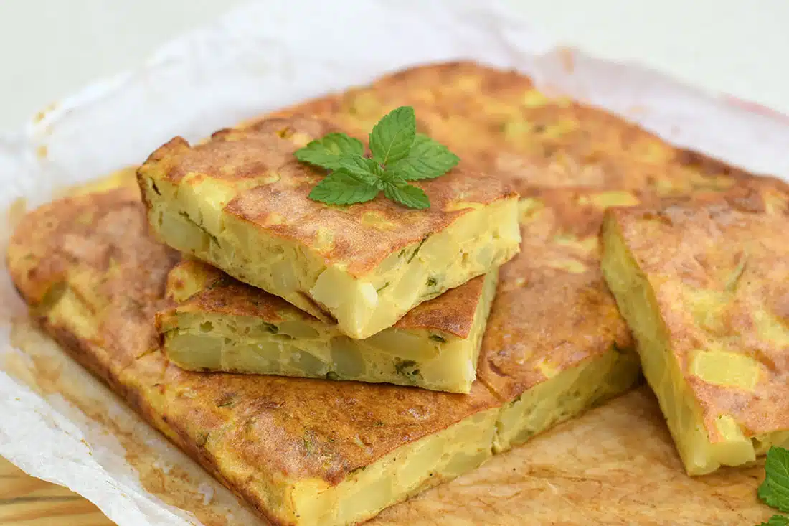

---
tags:
  - Uova
  - Patate
---

## Ingredienti

| Ingredienti                  | Ingredienti             |
| ---------------------------- | ----------------------- |
| **8** - Uova | **50 g** - Pan grattato |
| **50 g** - Parmigiano grattugiato | Olio evo |
| Sale e pepe | Menta |

## Procedimento

> Preriscaldate il forno ventilato a 180°C

1. Per preparare la frittata di patate al forno dovete partire dalle patate. Dovrete, infatti, lavarle accuratamente e poi sbucciarle con un pelapatate.
1. Una volta ripulite le patate andranno ridotte in piccoli cubetti che verserete direttamente all’interno di una teglia.
1. Condite ora le patate con dell’olio extravergine d’oliva e del sale a piacere. Donate ora una nota di profumo aggiungendo anche un rametto di rosmarino.
1. Fate cuocere in forno preriscaldato ventilato a 180°C per 20-25 minuti. Il tempo di cottura cambierà a seconda della grandezza dei cubetti che avete realizzato per cui regolatevi di conseguenza.
1. Quando le patate saranno cotte sfornatele e fatele freddare. 
1. A quel punto potrete concentrarvi sulle uova. Versatele all’interno di una ciotola ben capiente dove via via verserete tutti gli ingredienti, comprese le patate. Aggiungete il parmigiano reggiano grattugiato.
1. Versate anche il pangrattato, che donerà una struttura meravigliosa alla vostra frittata.
1. Aggiustate con del sale, tenendo conto anche della sapidità del formaggio che avete appena aggiunto. Se vi piace donate anche una spinta in più con del pepe nero macinato.
1. Mescolate tutti gli ingredienti con una forchetta.
1. E’ il momento di aggiungere la nota profumata che renderà questa frittata al forno con patate davvero eccezionale: la menta. Dovrete lavarla, tamponarla con un panno e quindi ridurre in pezzi.
1. Potete ora aggiungere anche le patate, che avete cotto prima e che ora saranno ben fredde.
1. Una volta incorporate anche le patate il composto è pronto. Versatelo all’interno di una teglia foderata con carta da forno. Livellate con la forchetta così da avere uno spessore uniforme.
16. Fate cuocere in forno preriscaldato ventilato a 180°C per 40-45 minuti o fino a doratura. Una volta pronta sfornatel, fate intiepidire e sarà pronta da portare a tavola.

## Origine

[link](https://www.tuorlorosso.it/frittata-di-patate-al-forno/)

