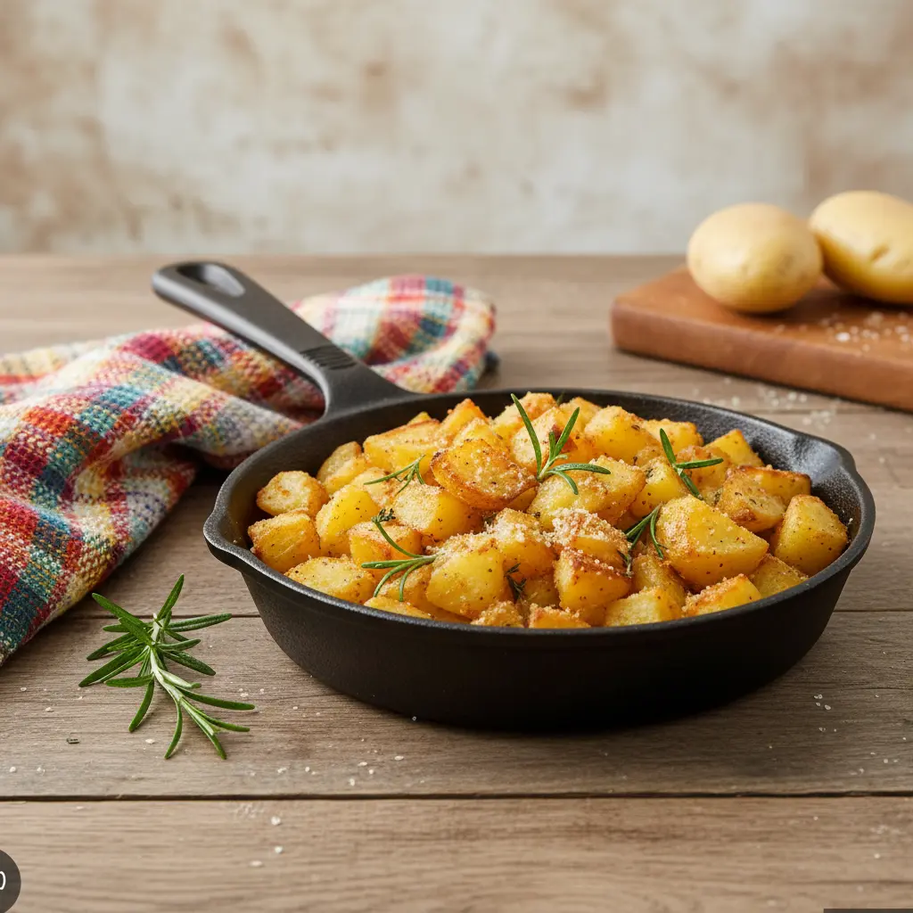

## Ingredienti

| Ingredienti                  | Ingredienti             |
| ---------------------------- | ----------------------- |
| **800g** - Patate a pasta gialla | **4 cucchiai** - Olio evo |
| **4 cucchiai** - Pan grattato | **3 cucchiai** - Parmigiano grattuggiato |
| **1 rametto** - Rosmarino tritato | **1 spicchio** - Aglio |
| Sale e pepe | |

## Procedimento

1. Sbucciare, lavare e tagliare a pezzetti le patate, tagliale a cubetti regolari.
1. Bollile per 7–8 minuti in acqua salata. Devono ammorbidirsi ma restare compatte. Scolale bene.
1. In una ciotola mescola: pangrattato, parmigiano, rosmarino tritato. Unisci le patate ancora calde e mescola delicatamente: il rivestimento aderirà creando l’effetto “sabbioso”.
1. In padella scalda l’olio con aglio. Unisci le patate e distribuiscile in uno strato unico. Cuoci a fiamma medio-alta senza girarle subito. Quando sotto si forma la crosticina, girale con delicatezza. Prosegui finché saranno ben dorate. Sala solo alla fine.

## Note

Si possono fare al forno? Sì, 200°C per 25–30 minuti.

## Origine

[link](https://blog.giallozafferano.it/renatabriano/ricetta-patate-sabbiose-in-padella-croccanti-fuori-e-morbide-dentro-il-trucco-infallibile/)

