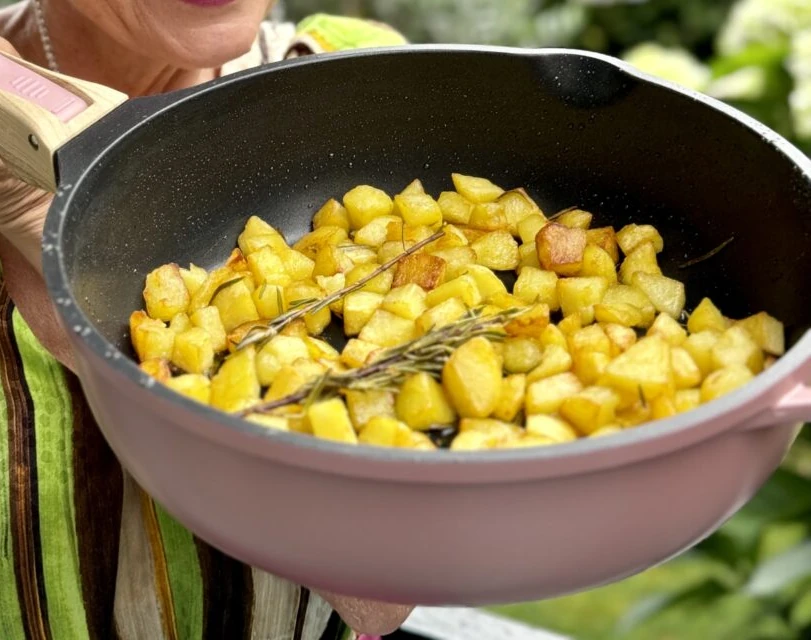

## Ingredienti

| Ingredienti                  | Ingredienti             |
| ---------------------------- | ----------------------- |
| **600g** - Patate a pasta gialla | **2 rametti** - Rosmarino |
| **1 spicchio** - Aglio | Olio evo |
| Sale | |

## Procedimento

1. Pelare le patate con il pelapatate e lavarle. Asciugarle e tagliarle a piccoli tocchetti. Più piccoli sono, più verranno croccanti.
1. Scaldare l’olio in un’ampia padella con i rametti interi di rosmarino e lo spicchio di aglio tagliato a metà e senza anima.
1. Quando è caldo, unire le patatine e friggerle mescolando fino a che non sono belle dorate.
1. Scolarle con la schiumarola e metterle ad asciugare su carta paglia.
1. Salare e servire subito belle calde e croccanti.

## Origine

[link](https://blog.giallozafferano.it/renatabriano/ricetta-patatine-fritte-della-nonna/)

